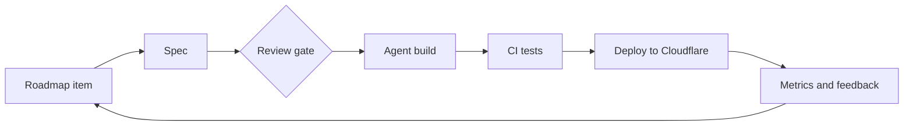
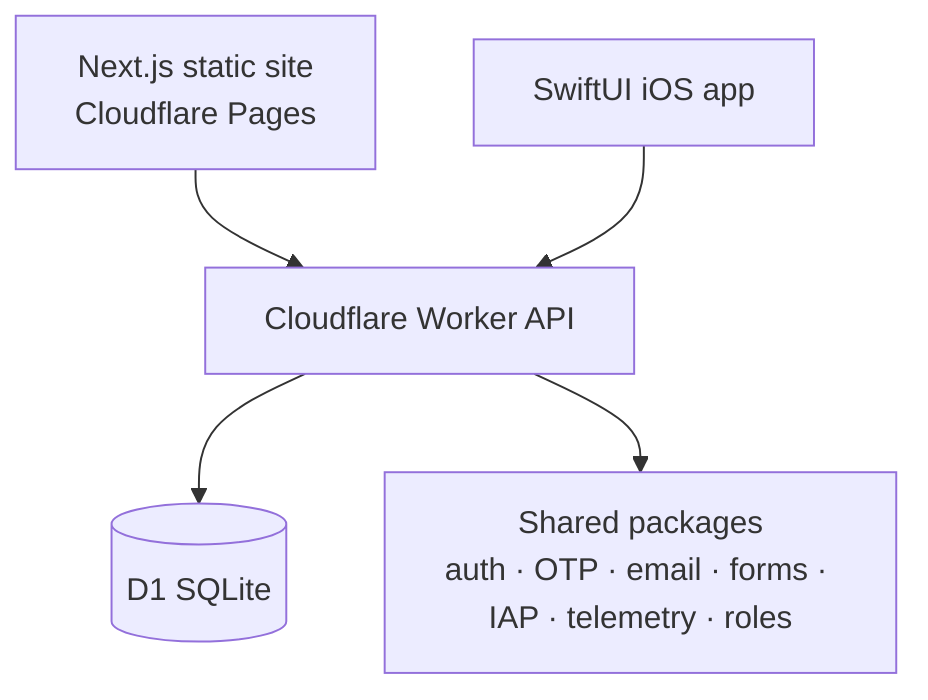

### Founder of [LatentEdge](https://latentedge.io) - AI products, automation, and full-stack engineering for web and iOS.

## Portfolio

| Live | Beta | Alpha | In development | iOS apps | Shared packages |
|:---:|:---:|:---:|:---:|:---:|:---:|
| **35** | **11** | **27** | **43** | **15** | **16** |

## Delivery pipeline

AI agents run each roadmap item through spec, build, test, and deploy, with human review at the gates that matter.

## Platform

Every app starts on the same stack and the same in-house packages.

## Selected products

| Product | Category | Platform |
|---|---|---|
| [Write My Card AI](https://writemycardai.com) | AI writing | Web |
| [Brain Dump](https://braindump.latentedge.io) | Voice-first productivity | Web |
| [The Grateful List](https://thegratefullist.com) | Wellness | Web, iOS |
| [Cernita](https://cernita.latentedge.io) | Photo management | Web, iOS |
| [SkatePhone](https://skatephone.com) | Sports | Web, iOS |
| [Lost Pet Radar](https://lostpetradar.com) | Community alerts | Web |
| [Life Lore](https://lifelore.latentedge.io) | Personal writing | Web |
| [Vibe Helping](https://vibehelping.com) | Website review tool | Web |
| [Feedback](https://feedback.latentedge.io) | Feedback widget | Web |

## Open source

| Repository | Description |
|---|---|
| [status-page](https://github.com/LatentFreedom/status-page) | Self-hosted status page: Next.js, Worker, and D1 from one config file |
| [hometodo](https://github.com/LatentFreedom/hometodo) | Self-hosted tracker for home and life tasks |
| [appstore-notifications-package](https://github.com/LatentFreedom/latentedge-appstore-notifications-package) | App Store Server Notifications V2 for Cloudflare Workers |
| [cloudflare_bulk_dns_updater](https://github.com/LatentFreedom/cloudflare_bulk_dns_updater) | Bulk-update A records across Cloudflare zones |

**Contact:** [nic@latentedge.io](mailto:nic@latentedge.io) · [latentedge.io](https://latentedge.io)
